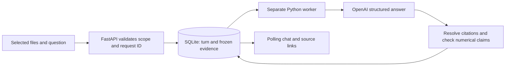

# Document question-answering sessions

## Using the interface

Open **Ask your documents** in the sidebar, choose one to ten source-extracted files, and enter a question. Enter sends; Shift+Enter adds a line. Suggestions only fill the draft. File selection alone does not call OpenAI.

The first question creates a conversation with a fixed file scope. Start **New chat** to choose a different scope. Conversations and completed answers are stored in SQLite and remain available after restart. Numbered source cards correspond to the answer's citation numbers and open the cited PDF page or Excel sheet. **Back to conversation** retains the active chat and draft.

The interface shows real queued, processing, ready, and failed states, rather than simulated streaming. Copy answer, loading guards, a jump-to-latest control, and explicit retry drafting support the conversation flow. The composer identifies OpenAI as the destination before submission. Model charges can apply when a question is sent.

## Request and worker flow

Endpoints:

- `GET /api/qa/sessions`: saved conversations.
- `POST /api/qa/sessions`: create a session from `document_ids`.
- `GET /api/qa/sessions/{id}`: fixed scope and persisted question/answer turns.
- `POST /api/qa/sessions/{id}/messages`: enqueue `question` and client `request_id`.

The turn is the durable queue record. User question, immutable evidence bundle, bounded completed conversation history, model, and status are saved atomically. A repeated request ID with the same question returns the same turn; reusing it for a different question is rejected. One active turn per conversation prevents conflicting follow-ups. Worker heartbeats and lease-fenced completion reject stale results.

An interrupted provider call fails explicitly after its lease expires. It is not automatically resent, because the provider may already have processed or charged for it. **Ask again** fills a draft; the user explicitly submits the replacement question.

## Grounding and limitations

Retrieval is deterministic and local, bounded to 200 records and 100,000 serialized record characters. Spreadsheet values travel with available same-column header and same-row label context. Omitted context and parser/OCR gaps remain visible as limitations. Recent questions help retrieve follow-up context; prior answers are not treated as new source evidence.

### Detailed conversational answers

New questions use prompt `document-chat-detailed-v1`: a direct answer followed by
relevant reported data, context and source-supported explanation. Broad questions
receive fuller coverage when evidence permits; explicit requests for brevity
are respected. Answers must not be padded or expanded with invented information.
The completion budget is 8,000 tokens, increased from 2,500, to leave room for
longer cited answers. This is a ceiling, not a required length.

Claims can carry a neutral section label, rendered as headings with natural
paragraphs rather than a mandatory bullet per sentence. Headings are restricted
to schema-defined labels so they cannot introduce unvalidated factual claims.
Each paragraph retains its citations; rejected claims and their headings do not
appear in the public answer. Existing claim-only saved answers remain replayable.
The existing UI already renders headings, paragraphs, lists and citation links.
The prompt version and hash are retained in the answer audit.

The approach follows [OpenAI's prompting guidance](https://developers.openai.com/api/docs/guides/prompt-engineering)
on explicit instructions, output format and relevant source context. More detail
does not establish semantic accuracy. Numerical evidence checks, document scope,
uncertainty notices and the separate deterministic calculation path remain active.
Existing saved answers are not rewritten, and no live user-document request is
required to install or test this change.

Verification for the detailed-answer update: 60 Q&A, persisted worker-flow,
context-balance, section-rendering and calculation tests passed using synthetic
evidence and mocked providers. The API and worker were reloaded with no active
jobs interrupted. New questions use the updated prompt; saved answers remain
unchanged. Live model verbosity has not been independently evaluated in this run.

Each citation ID is namespaced by document. Its quotation, filename, page/sheet, cells, document digest, and source digest resolve from the frozen submitted bundle, not from model-supplied locations. Out-of-scope and unknown citation IDs fail validation. Original source lines remain **unreviewed source text**, even if one fact on that line previously passed an automated check. A server-added notice preserves this distinction on cited answers.

The QA system prompt starts with the assignment's required Harvey Specter sentence and treats document instructions as untrusted content. Responses use strict JSON Schema with cited claims and limitations. Numerical checks preserve cited strings, signs, units, scales, currencies, and qualifiers; separate spreadsheet unit headers must belong to the same document, sheet, and column. Unsupported numerical comparisons are rejected. These checks establish bounded provenance, not proof of every semantic interpretation. Conservative validation can reject otherwise reasonable reformatted answers.

This milestone supports reported-value lookups and cited summaries. It does **not** implement a calculation engine, unit conversion, overlap-aware aggregation, or Indian financial-year totals. Explicit calculation/FY-total requests return a limitation. A financial-year boundary helper is tested, but it is not a completed financial-year reporting feature. A document-reported total can still be looked up without calculating a new total.

## Verification

### Numeric-format correction and offline recovery

The first real overview question failed because the numeric guard rejected legitimate compound formats. Replaying its frozen evidence against the previous validator found five false rejections among 117 verbatim source passages. The corrected validator accepts all 117, while preserving tests for fabricated numbers, units, scales, signs, qualifiers, dates, identifiers, and out-of-scope citations. This is a format-regression check, not an answer-accuracy score.

Cited ordinals, dates, invoice identifiers, and alphanumeric standards are checked as complete source-supported spans. Model claims are validated individually: supported claims survive, while unsupported claims are omitted with a limitation. New proposals and rejection reasons are saved privately with model, prompt hash, evidence hash, and validator version, enabling later offline replay.

Normal questions, including broad summaries, continue to use OpenAI. A broad answer with no valid returned claims may fall back to an explicitly labeled local overview of source excerpts; authentication, quota, network, and provider-refusal errors are never hidden by this fallback. Local excerpts prioritize meaningful billing fields and policy commitments, omit contact/copyright noise, and join narrative lines only within the same page and reading block while retaining the original citations.

The earlier failed provider response was not stored and could not be reconstructed. Its displayed error was replaced explicitly with a local overview from the original frozen evidence: five billing excerpts and one policy commitment, supported by seven original citations across the two selected documents. The old error and prior projection remain in `qa_local_history`; the evidence snapshot was not changed. No document was resent.

The updated full backend suite passed 117 tests with mocked provider calls. This does not replace live QA evaluation or the assignment's final source-verified answer baseline and improvement run.

The initial backend implementation passed 94 tests, including an isolated synthetic upload → session → question → mocked OpenAI response → validated citation → follow-up → restart flow. Tests cover selected-file isolation, idempotency, one active turn, stale completion, missing configuration, citation rejection, quantities/units/qualifiers, source status, and spreadsheet context retrieval. No user document or key was transmitted in these tests.

The frontend production build and nine existing frontend tests passed. Manual browser checks confirmed sidebar access, multiple-file selection, selected-file chips, suggestion-to-draft behavior, disabled sending without a question, and composer disclosure. These checks did not submit a real question. Local read-only retrieval checks found the expected water consumption, water amount, annual workbook value, and Adani consumption records. No new live OpenAI request was made.

The assignment's ten source-verified QA cases, baseline/improvement scoring, and live answer-quality evaluation remain a separate milestone.

### Spacious chat layout

Conversation history is an on-demand overlay, leaving the existing workspace sidebar as the primary navigation. The centered composer includes a document picker with a selected-file count; after the first question its document list is read-only, preserving the conversation's evidence scope. Source cards and detailed limitations expand on demand, with a visible limitations notice retained beside the disclosure.

The transcript scrolls independently inside a bounded viewport. Sending, queued, and generating indicators follow actual request/job states; answer entrance animations do not simulate streamed model output. Reduced-motion preferences disable animations. This presentation change does not alter retrieval, validation, persistence, or provider requests.

### Clearer answers

The `document-chat-detailed-v3` prompt requests developed explanations, explicit coverage of each supported question part, and material conditions and exceptions. Broad questions with rich evidence guide the model toward 6–12 distinct cited claims without forcing padding. Narrow questions and explicit requests for brevity remain proportionate. The completion budget is 12,000 tokens, including model reasoning. The configured application model is `gpt-5-nano`. Existing saved answers are unchanged; new questions use the updated prompt after the backend restarts. Mocked regression tests verify request compatibility and citation handling, not live answer quality.

The QA prompt now requests complete, direct sentences and meaningful reported details. Multiple validated points render as a readable bullet list; one point stays a paragraph. Broad overviews reserve equal record/character budgets for each selected document before filling spare space by relevance. Truncation remains visible; balanced coverage does not imply a complete document summary.

The UI renders paragraphs, lists, simple headings and bold text as React elements, with valid numbered references opening their source. It never executes model-supplied HTML. Specific short model-reported uncertainty is retained only within a bounded, non-numeric uncertainty format; unsupported claims remain subject to the existing checks. Calculation and empty-evidence responses explain the current limitation directly. Existing saved responses retain their original wording; prompt changes apply to newly asked questions.

PDF retrieval bundles adjacent lines within the same page and reading-order block so incomplete line fragments have sentence context, while every line retains its original citation ID. Verification used mocked provider responses: 121 backend tests passed, followed by two context-balance tests including the added PDF regression; all 11 frontend tests and the production build passed. No live answer-quality claim is made from these checks, and no document was resent for verification.
